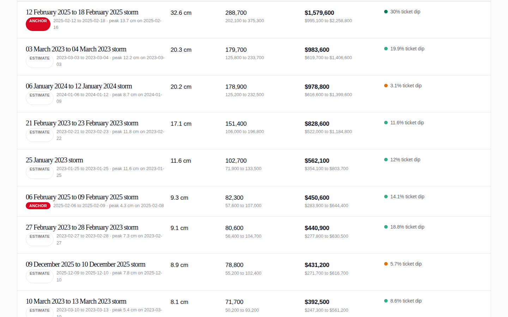
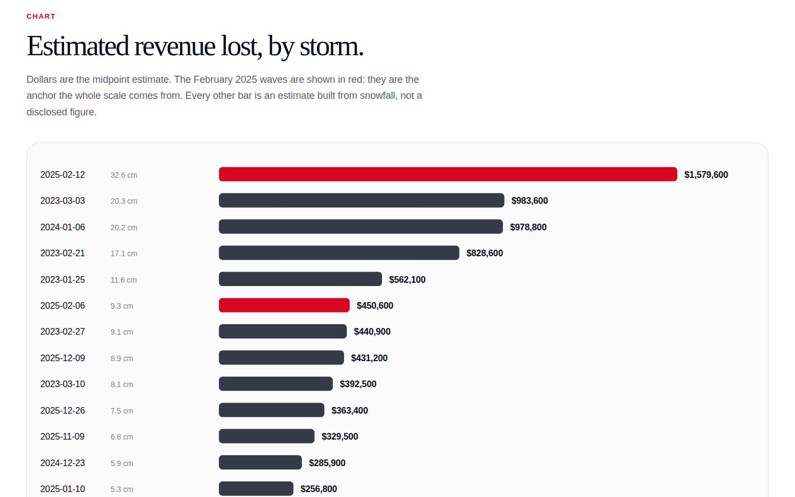

# Toronto parking revenue lost to snowstorms, 2023-2025

**13 snowstorms cost an estimated $7.9M over three winters. The largest, in February 2025, cost about $1.6M.**

Toronto Parking Authority disclosed the cost of exactly one storm in full. In its 2026 Operating Budget report (25 November 2025, page 1), TPA says the lengthy snow event in February 2025 closed 47% of its on-street inventory for snow removal and caused 371,000 fewer transactions. This project takes that single disclosure as an anchor, works out what one centimetre of snowfall costs in lost parking transactions, and applies the rate to every major snowfall from 2023 to 2025. Every estimate carries a low and high band, and every storm is cross-checked against parking ticket counts.

An open-source civic project. Not affiliated with the Government of Canada or the City of Toronto.

## Screenshots

## What the data shows

(Findings computed by `scripts/build_data.py`; numbers below come from `data/summary.json` and `data/storms.json`.)

- 13 storms meet the definition of major (5 cm or more in an event) between January 2023 and December 2025.
- The estimated total loss across all 13 storms is 1,440,500 paid transactions and $7,883,500 in revenue. The band on the revenue total runs from $4,966,600 (low) to $11,273,200 (high).
- The single costliest storm is the 12 to 18 February 2025 wave: 32.6 cm of snow, an estimated 288,700 transactions lost and $1,579,600 in revenue lost (band $995,100 to $2,258,800). Together with the 6 to 9 February wave, it reproduces the disclosed anchor of 371,000 transactions and about $2,030,200 in revenue.
- The next costliest storms are 3 to 4 March 2023 (20.3 cm, $983,600 estimated) and the 6 to 12 January 2024 snow week (20.2 cm, $978,800 estimated).
- The ticket cross-check supports 9 of 13 estimates. Four storms are flagged weak in the dataset because ticket counts fell less than 8% against baseline: the 6 to 12 January 2024 week (3% dip), 10 to 13 January 2025 (5%), 9 November 2025 (1%), and 9 to 10 December 2025 (6%). Those flags are kept in the data. They are not averaged away.

## Files

- `data/storms.csv` and `data/storms.json`: one row per storm: dates, snowfall, estimated transactions lost, estimated revenue lost, low and high bands, method tag, cross-check verdict and note
- `data/summary.json`: the anchor facts, calibration math, event definition, and 3-year totals
- `data/snowfall_daily.csv`: daily snowfall for Toronto, 2023-2025, the full series the events were detected from
- `data/daily_tickets.json`: daily City parking ticket counts, 2023-2025, used only for the cross-check
- `data/app_data.json`: compact bundle consumed by the app (summary, storms, monthly rollup)
- `data/raw_openmeteo_era5.json`: the cached Open-Meteo API response the snowfall series came from
- `data/tpa_2026_budget_report.pdf`: the TPA 2026 Operating Budget report, the anchor source document
- `scripts/build_data.py`: the full pipeline. It fetches snowfall, detects events, calibrates, estimates, cross-checks, and writes every output above

## Methodology

### Fact, estimate, inference

This project separates three kinds of number and labels them everywhere, including in the user interface.

- Fact: numbers TPA or the City published. The 371,000 transactions lost, the 47% of on-street inventory closed, the $177.3 million 2025 forecast revenue, the 32.4 million forecast transactions, and the 6,454,695 parking tickets in the City files.
- Estimate: every per-storm loss in the dataset. Each is a model output with a low and high band.
- Inference: the bridge between them, meaning the transactions-per-centimetre rate. It assumes the February 2025 relationship between snowfall and lost transactions holds for other storms.

### Step 1: The anchor

Source: Toronto Parking Authority, "2026 Operating Budget and 2026-2028 Capital Budget", report to the Board of Directors, 25 November 2025, page 1: "Revenues are forecasted at a historic high of $177.3 million which is -$5.4 million versus plan driven by soft transaction performance in our parking portfolio. This was due in part to the lengthy snow event in February that closed 47% of our on-street inventory for snow removal resulting in 371 thousand fewer transactions."

Supporting figures from the same report: 2026 on-street revenue is budgeted at $67.7 million. The 2025 forecast pairs $177.3 million of revenue with 32.4 million total transactions.

### Step 2: Snowfall, and a documented substitution

The plan called for Environment Canada daily data for Toronto. Three download routes were tried from the build network on 20 October 2026: the bulk CSV download at climate.weather.gc.ca, the same station through the api.weather.gc.ca GeoMet service, and NOAA GHCN station files. The Environment Canada hosts returned empty replies through the build proxy and the NOAA paths returned 404. Meteostat was also checked: its snowfall column for Toronto stations is empty after December 2022.

The substitute is the Open-Meteo archive API, which serves ERA5 reanalysis daily snowfall at 43.65N, 79.38W (downtown Toronto), 1 January 2023 to 31 December 2025, with no missing days. Two cautions apply. First, ERA5 is a model estimate on a grid of about 25 km, not a station gauge; it smooths local extremes and its February 2025 total (49.1 cm for the month at the grid point) sits below some station reports. Second, because the same series is used both to measure the anchor event and to measure every other event, a consistent bias in ERA5 partly cancels in the rate. The cached API response is kept at `data/raw_openmeteo_era5.json` so the dataset can be rebuilt offline. If Environment Canada data becomes reachable, re-running the pipeline with station data is a one-source swap in `scripts/build_data.py` and every number in the dataset would move; the methodology and the calibration structure would not change.

### Step 3: What counts as a major storm

The definition is mechanical so a future storm can be classified the day it ends.

- A snow day is a day with snowfall of 1.0 cm or more.
- An event is a maximal run of snow days, allowing one gap day below 1.0 cm inside the run (a storm that pauses for a day is still one storm).
- An event qualifies as a major storm when its total snowfall, summed across every day from the first snow day to the last, reaches 5.0 cm.

Thirteen events qualify in 2023-2025. The February 2025 episode resolves to two events under this rule: 6 to 9 February (9.3 cm) and 12 to 18 February (32.6 cm). The anchor treats them as one episode, because TPA's sentence describes the February event as a single lengthy disruption and snow removal from the first wave was still under way when the second wave landed. Ticket counts support the episode reading: daily tickets stayed below the local baseline continuously from 8 February to 23 February 2025.

### Step 4: Calibration math

- Episode snowfall: 9.3 cm + 32.6 cm = 41.9 cm.
- Rate: 371,000 transactions / 41.9 cm = 8,854 transactions lost per centimetre of snowfall.
- Per-storm transactions lost = rate x storm snowfall.
- Price per transaction: $177,300,000 / 32,400,000 = $5.47, the blended rate across on-street and off-street parking in TPA's 2025 forecast.
- Per-storm revenue lost = transactions lost x $5.47.

Hand check for the largest storm: 32.6 cm x 8,854.4 transactions per cm (the rate before display rounding) = 288,654 transactions, stored as 288,700 after rounding to the nearest hundred. 288,654 x $5.4722 = $1,579,578, stored as $1,579,600. The two anchor rows together: 82,300 + 288,700 = 371,000 transactions, exactly the disclosed figure, by construction.

Two limits on the rate deserve plain statement. First, it is one observation. February 2025 had back-to-back waves, a declared major snowstorm condition, and weeks of removal work; a single 15 cm storm in a quiet month may close fewer stalls per centimetre. Second, the $5.47 price blends off-street garage sessions with on-street meter sessions, while the 371,000 lost transactions were on-street. TPA does not publish a transaction split, so a cleaner on-street price cannot be computed from public data. A lost metered space forgoes roughly $3,200 a year in revenue on TPA's 2026 on-street budget ($67.7 million over 21,000 spaces), which is context for the scale of each closure, not an input to the estimator.

### Step 5: Confidence bands

Every estimate ships with a low and a high value.

- Transactions: the rate carries plus or minus 30%. The band is wide on purpose. It covers the alternative reading of the anchor where the 371,000 transactions belong only to the larger 12 to 18 February wave, which would put the rate at 11,380 per centimetre, 28.5% above the primary rate.
- Price: $5.47 carries plus or minus 10%, giving $4.92 to $6.02, for the blend problem described above.
- Revenue low = transactions low x $4.92. Revenue high = transactions high x $6.02. The combined band is therefore about minus 37% to plus 43% around the midpoint.

### Step 6: The ticket cross-check

The City of Toronto publishes every parking ticket. Daily counts for 2023-2025 were computed from the same raw files used by the reference project toronto-parking-tickets-geocoded (6,454,694 of 6,454,695 tickets carry a parseable date; one row does not). For each storm:

- The impact window runs from the first snow day through 6 days after the last snow day, covering the removal period.
- The baseline is the mean daily ticket count over the 28 days before the window and the 28 days after it, with days inside any other storm's impact window removed.
- The dip is 1 minus (window mean / baseline mean). Verdicts: agrees_strong at a dip of 20% or more, agrees_moderate at 8% to 20%, weak below 8%, disagrees if ticket counts rose.

Tickets measure enforcement activity on the street: officers writing fewer tickets can mean cars could not park, officers were redeployed, or drivers stayed home. Tickets are never used as a revenue input. Where the verdict is weak, the storm row keeps the estimate and prints the disagreement. Three of the weak verdicts land on holiday-adjacent or weekend-heavy windows (Christmas, Boxing Day, a November Sunday storm), and the notes say so where a statutory holiday falls inside the window.

### Pricing the next storm

Within days of a future storm, the same procedure gives its price:

1. Add the new days to the snowfall series (Open-Meteo updates daily; Environment Canada station data can replace it when reachable).
2. Run `python3 scripts/build_data.py`. It re-detects events, keeps the February 2025 calibration, and emits the new storm with its band.
3. When the City publishes that month's ticket file, the cross-check for the new storm fills in on the same run.
4. If TPA ever discloses a second storm's transaction loss, recalibrate: the rate should then be fitted to both anchors and the band should narrow. The dataset format already carries a method tag per storm so anchor rows and modelled rows stay distinguishable.

## API

REST under `/api/v1/storms/` (`GET /api/v1/storms`, `GET /api/v1/storms?id=S10`, `GET /api/v1/storms/summary`). OpenAPI 3.1 at `/api/openapi.json`. MCP at `POST /mcp` with tools `storms_list`, `storm_detail`, `storms_summary`.

## Author

**Richardson Dackam** - [X (@richardsondx)](https://x.com/richardsondx) · [GitHub](https://github.com/richardsondx)
